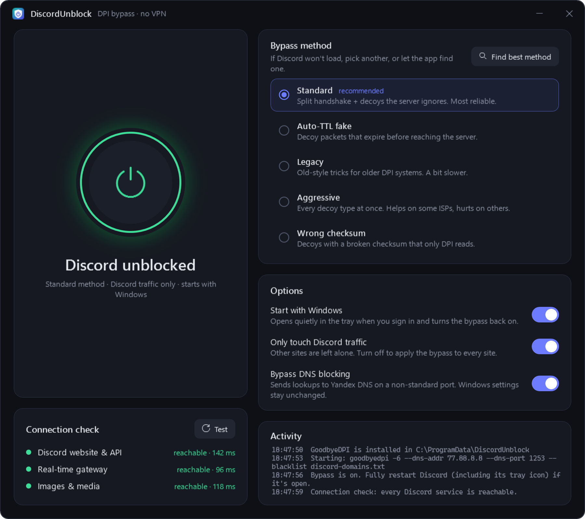
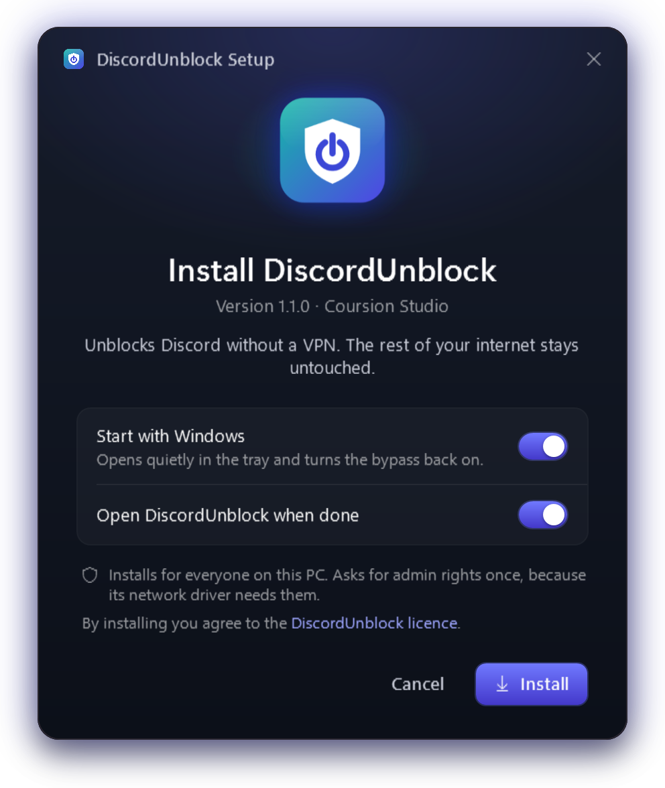
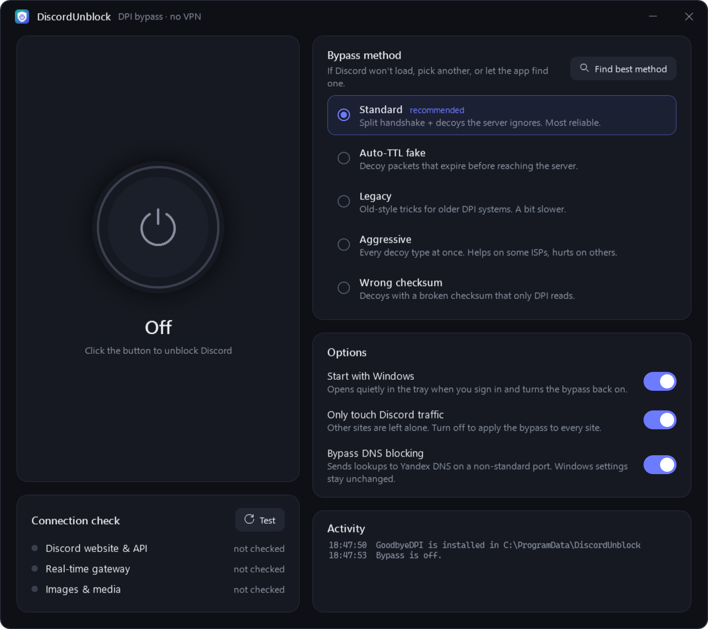

  

  
  
  
  
  
  

  <b>Discord blocked by your internet provider? One click and it works again.</b> 
  No VPN, no proxy, no slowdown. Only your connections to Discord are touched, 
  and the rest of your internet stays exactly as it was.

  <a href="https://github.com/Coursion-Studio/discordunblock-windows/releases/latest"><b>⬇ Download DiscordUnblock</b></a>
  &nbsp;·&nbsp; <a href="#-install">Install</a>
  &nbsp;·&nbsp; <a href="#-features">Features</a>
  &nbsp;·&nbsp; <a href="#-screenshots">Screenshots</a>
  &nbsp;·&nbsp; <a href="#-faq">FAQ</a>

---

  

## 🚀 Install

1. Download **`DiscordUnblockSetup-x.y.z.exe`** from the [latest release](https://github.com/Coursion-Studio/discordunblock-windows/releases/latest).
2. Open it, allow the admin prompt, and click **Install**.
3. DiscordUnblock opens. Click the big **power button**, then restart Discord.

  
  

Setup adds DiscordUnblock to the **Start menu**, can **start it with Windows**, and registers it under
**Settings → Apps → Installed apps**. Running a newer `DiscordUnblockSetup` **updates it in place** and keeps your settings.

> **"Windows protected your PC"?** This SmartScreen warning appears because the installer isn't code-signed yet.
> Click **More info → Run anyway**. Each release includes a `.sha256` file so you can verify the download.

**Why admin rights?** DiscordUnblock works through a small network driver (WinDivert), and Windows only lets
administrators load drivers. Setup asks once, and the app asks when it starts.

**Uninstall:** **Settings → Apps → Installed apps → DiscordUnblock → Uninstall**. It removes the app, the network driver,
the Start menu shortcut and Start with Windows. You choose whether to keep your settings.

**Requirements:** 64-bit Windows 10 or 11. If the .NET 8 Desktop Runtime isn't installed, setup downloads it from
Microsoft for you.

## ✨ Features

|   |   |
|---|---|
| ⏻ **One button** | Click the power button and Discord loads again. Click it again to turn everything off. |
| 🎯 **Only Discord** | By default the bypass only touches Discord's own servers. Every other site and app goes out exactly as before. |
| 🧪 **Find best method** | Internet providers block in different ways. The app tries each method with 12 real connections to Discord and keeps the one that works best on your network. |
| 🩺 **Connection check** | See at a glance whether Discord's website, its real-time gateway and its image servers are reachable, with response times. |
| 🌐 **DNS fix built in** | Many providers also return fake addresses for Discord. DiscordUnblock asks a different DNS server on a non-standard port, without changing your Windows settings. |
| 🛡️ **Lives in the tray** | Close the window and it keeps working. The shield icon turns green when Discord is unblocked. |
| 🔁 **Start with Windows** | Opens quietly in the tray when you sign in and turns the bypass back on, with no admin prompt at login. |
| 🔒 **No VPN, no account** | Your traffic isn't routed through anyone's server. No account, no analytics, no telemetry. |

## 📸 Screenshots

  
  

  
  

## ❓ FAQ

<b>Is this a VPN? Will it slow down my internet?</b>

No. A VPN sends all your traffic through someone else's server. DiscordUnblock doesn't send your traffic anywhere:
it only changes how your PC's own connections to Discord are packaged, so your provider's filter can't recognise
them. Speed and ping stay the same, and other sites aren't affected.

<b>I turned it on, but Discord still won't load</b>

1. Quit Discord completely (right-click its tray icon → **Quit Discord**) and open it again.
2. Click **Find best method** in DiscordUnblock and let it test every method.
3. Still blocked? Turn off **Only touch Discord traffic** under **Options**, and make sure no VPN or other
   bypass tool is running at the same time.

<b>My antivirus warns about WinDivert</b>

WinDivert is the open-source network driver DiscordUnblock uses. Some antivirus programs flag it because it can see
network traffic. It's downloaded from its official release page, and the app only uses it for connections to Discord.

<b>Where does it keep its files?</b>

The app is in `C:\Program Files\DiscordUnblock`. Its settings and the GoodbyeDPI files it downloads on first use are
in `C:\ProgramData\DiscordUnblock`. Uninstalling removes both if you turn on **Also remove settings and downloads**.

<b>How do I stop it starting with Windows?</b>

Open DiscordUnblock and turn off **Options → Start with Windows**.

## 🐛 Issues & feedback

Open an issue on this repo, or email [support@coursion.studio](mailto:support@coursion.studio).
The source code lives in a private repo. This one hosts the releases and this page.

## 📄 Licence

Proprietary. See [LICENSE.md](LICENSE.md). © 2026 Coursion Studio. All rights reserved.
Questions: [support@coursion.studio](mailto:support@coursion.studio) · [coursion.studio](https://coursion.studio)

DiscordUnblock downloads and runs [GoodbyeDPI](https://github.com/ValdikSS/GoodbyeDPI) (Apache License 2.0), which
includes [WinDivert](https://github.com/basil00/WinDivert) (LGPL v3). DiscordUnblock is not affiliated with or endorsed
by Discord Inc. "Discord" is a trademark of Discord Inc. You're responsible for making sure using it is allowed where
you live and on the network you use.
