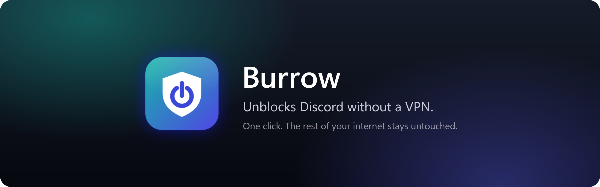
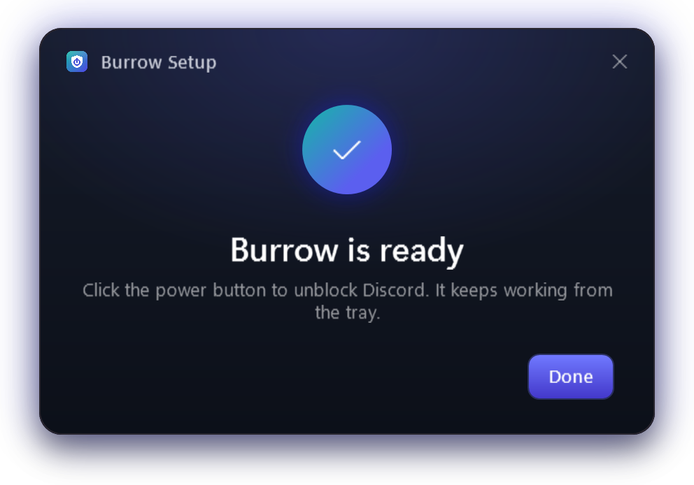
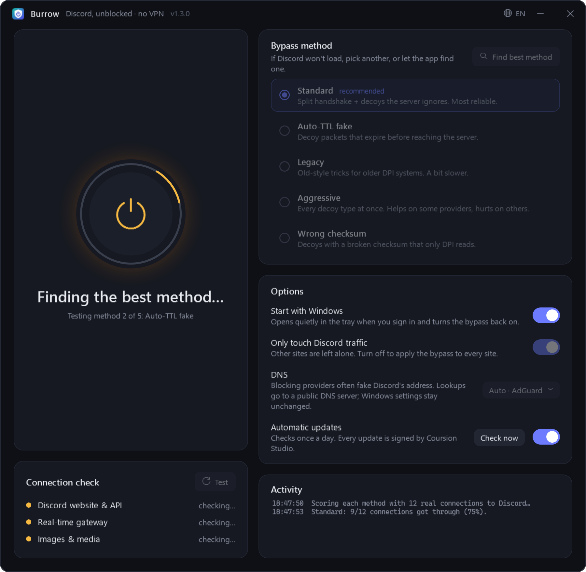
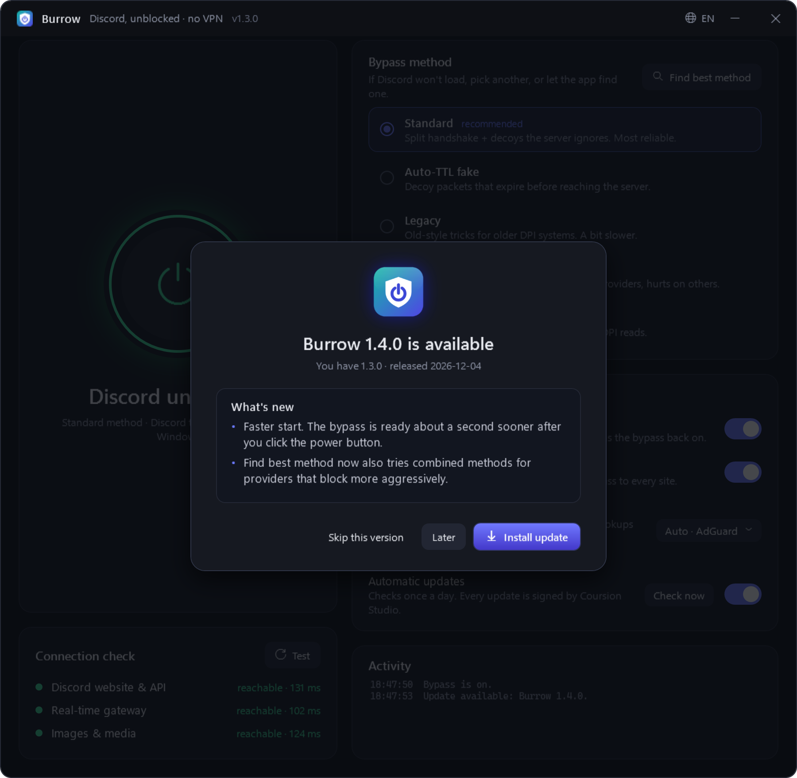
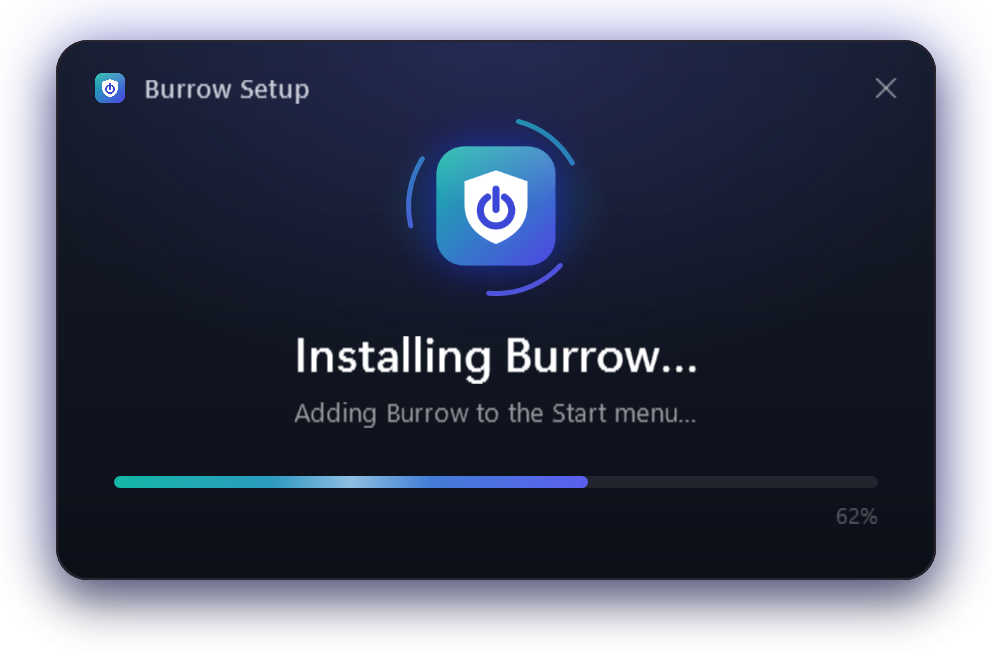
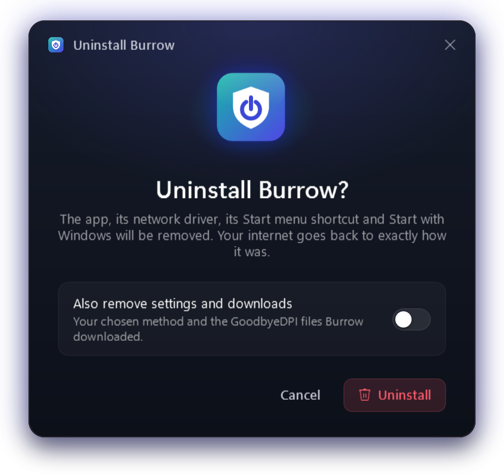

<p align="center">
  
</p>

<p align="center">
  <a href="https://github.com/Coursion-Studio/burrow-windows/releases/latest"></a>
  <a href="https://github.com/Coursion-Studio/burrow-windows/releases"></a>
  
  
  
  <a href="LICENSE.md"></a>
  <a href="https://github.com/Coursion-Studio/burrow-windows/actions/workflows/build.yml"></a>
</p>

<p align="center">
  <b>Discord blocked by your internet provider? One click and it works again.</b><br>
  No VPN, no proxy, no slowdown. Only your connections to Discord are touched,<br>
  and the rest of your internet stays exactly as it was. Free and open source.<br>
  <sub>English · Türkçe · Русский</sub>
</p>

<p align="center">
  <a href="https://github.com/Coursion-Studio/burrow-windows/releases/latest"><b>⬇ Download Burrow</b></a>
  &nbsp;·&nbsp; <a href="#-install">Install</a>
  &nbsp;·&nbsp; <a href="#-features">Features</a>
  &nbsp;·&nbsp; <a href="#-screenshots">Screenshots</a>
  &nbsp;·&nbsp; <a href="#-faq">FAQ</a>
  &nbsp;·&nbsp; <a href="#%EF%B8%8F-build-from-source">Source</a>
</p>

---

<p align="center">
  
</p>

## 🚀 Install

1. Download **`BurrowSetup-x.y.z.exe`** from the [latest release](https://github.com/Coursion-Studio/burrow-windows/releases/latest).
2. Open it, allow the admin prompt, and click **Install**.
3. Burrow opens and finds the best method for your network. If Discord was already open, click **Restart Discord**.

<p align="center">
  
  
</p>

Setup adds Burrow to the **Start menu**, can **start it with Windows**, and registers it under
**Settings → Apps → Installed apps**. After that, Burrow **updates itself**: it checks once a day, shows what's
new, and installs with one click, keeping your settings.

> **"Windows protected your PC"?** This SmartScreen warning appears because the installer isn't code-signed yet.
> Click **More info → Run anyway**. Each release includes a `.sha256` file so you can verify the download.

**Why admin rights?** Burrow works through a small network driver (WinDivert), and Windows only lets
administrators load drivers. Setup asks once, and the app asks when it starts.

**Uninstall:** **Settings → Apps → Installed apps → Burrow → Uninstall**. It removes the app, the network driver,
the Start menu shortcut and Start with Windows. You choose whether to keep your settings.

**Requirements:** 64-bit Windows 10 or 11. If the .NET 8 Desktop Runtime isn't installed, setup downloads it from
Microsoft for you.

## ✨ Features

|   |   |
|---|---|
| ⏻ **One button** | Click the power button and Discord loads again. Click it again to turn everything off. |
| 🎯 **Only Discord** | By default the bypass only touches Discord's own servers. Every other site and app goes out exactly as before. |
| 🧪 **Find best method** | Internet providers block in different ways. Burrow tries each method with 12 real connections to Discord and keeps the one that works best on your network. It does this by itself on first start. |
| 🩹 **Fixes itself** | Every few minutes Burrow checks that Discord still gets through. If GoodbyeDPI stops or your provider changes how it blocks, Burrow restarts it or switches to a method that works, and tells you. |
| 🔄 **Restart Discord** | If Discord was already open when you turned the bypass on, one click restarts it so it reconnects through the bypass. |
| 🩺 **Connection check** | See at a glance whether Discord's website, its real-time gateway and its image servers are reachable, with response times. |
| 🌐 **Your choice of DNS** | Many providers also return a fake address for Discord. **Auto** picks the most private server that gives Discord's real address (AdGuard, Quad9, Cloudflare, Google or Yandex), or pick one yourself. Windows settings aren't touched. |
| 🛡️ **Lives in the tray** | Close the window and it keeps working. The shield icon turns green when Discord is unblocked. |
| 🔁 **Start with Windows** | Opens quietly in the tray when you sign in and turns the bypass back on, with no admin prompt at login. |
| 🔄 **Automatic updates** | Checks once a day, shows what's new, and installs with one click, then reopens with the bypass back on. Every update is signed by Coursion Studio and checked before it runs. |
| 🗣️ **Your language** | English, Türkçe and Русский. Follows your Windows language, or pick one from the title bar. |
| ✅ **Verified downloads** | GoodbyeDPI is pinned to a known version and checked against its SHA-256 before it ever runs. |
| 🔒 **No VPN, no account** | Your traffic isn't routed through anyone's server. No account, no analytics, no telemetry. The only calls the app makes itself are fetching GoodbyeDPI, the connection check and the daily update check. |

## 📸 Screenshots

<p align="center">
  
  
</p>
<p align="center">
  
</p>
<p align="center">
  
  
</p>

## ❓ FAQ

<details>
<summary><b>Is this a VPN? Will it slow down my internet?</b></summary>

No. A VPN sends all your traffic through someone else's server. Burrow doesn't send your traffic anywhere:
it only changes how your PC's own connections to Discord are packaged, so your provider's filter can't recognise
them. Speed and ping stay the same, and other sites aren't affected.
</details>

<details>
<summary><b>I turned it on, but Discord still won't load</b></summary>

1. Quit Discord completely (right-click its tray icon → **Quit Discord**) and open it again.
2. Click **Find best method** in Burrow and let it test every method.
3. Still blocked? Turn off **Only touch Discord traffic** under **Options**, and make sure no VPN or other
   bypass tool is running at the same time.
</details>

<details>
<summary><b>My antivirus warns about WinDivert</b></summary>

WinDivert is the open-source network driver Burrow uses. Some antivirus programs flag it because it can see
network traffic. It's downloaded from its official release page, and the app only uses it for connections to Discord.
</details>

<details>
<summary><b>Where does it keep its files?</b></summary>

The app is in `C:\Program Files\Burrow`. Its settings and the GoodbyeDPI files it downloads on first use are
in `C:\ProgramData\Burrow`. Uninstalling removes both if you turn on **Also remove settings and downloads**.
</details>

<details>
<summary><b>How do updates work? Can I turn them off?</b></summary>

Once a day Burrow reads a small file from this repo's latest release. If there's a newer version, it shows
what's new and lets you **Install update**, **Later**, or **Skip this version**. Before running anything it checks the
download's SHA-256 and its digital signature; if either doesn't match, nothing is installed. Turn checks off under
**Options → Automatic updates**, and use **Check now** (or the tray menu) whenever you like.

On DiscordUnblock 1.1.0? That version had no updater, so download the latest installer once from the releases page.
</details>

<details>
<summary><b>What happened to DiscordUnblock?</b></summary>

It's the same app with a new name. DiscordUnblock 1.2.0 updates itself to Burrow: your method, settings and
Start with Windows carry over, and the old version is removed automatically.
</details>

<details>
<summary><b>How do I stop it starting with Windows?</b></summary>

Open Burrow and turn off **Options → Start with Windows**.
</details>

## 🛠️ Build from source

Burrow is open source. This repo has the full source of the app:

| Path | What's in it |
|---|---|
| [`BurrowApp/`](BurrowApp) | The app (WPF, .NET 8). [`Engine.cs`](BurrowApp/Engine.cs) downloads (pinned and verified), starts and stops GoodbyeDPI and holds the bypass methods; [`DnsChoice.cs`](BurrowApp/DnsChoice.cs) picks the DNS server; [`MainWindow.xaml.cs`](BurrowApp/MainWindow.xaml.cs) is the window and tray icon; [`Updater.cs`](BurrowApp/Updater.cs) is the signed updater; [`Strings.cs`](BurrowApp/Strings.cs) has every translation. |
| [`Shared/`](Shared) | [`IconArt.cs`](Shared/IconArt.cs) draws every icon in code; [`StartupTask.cs`](Shared/StartupTask.cs) is Start with Windows. |
| [`legacy/`](legacy) | The original one-file PowerShell version (from when the app was called DiscordUnblock). Double-click `DiscordUnblock.cmd` to use it without building anything. |

To build it you need the [.NET 8 SDK](https://dotnet.microsoft.com/download):

```powershell
git clone https://github.com/Coursion-Studio/burrow-windows
cd burrow-windows
.\build.ps1          # -> dist\Burrow.exe
```

`dist\Burrow.exe` runs on its own: it asks for admin rights, downloads GoodbyeDPI on first use and keeps
its settings in `C:\ProgramData\Burrow`. The installer in Releases is built separately and isn't part of this repo.

Pull requests are welcome, especially new bypass methods that work for your provider (add them to `Methods.All` in
`Engine.cs` and say which country and provider you tested on) and new translations (add a table to `Strings.cs`).
Every push is built by GitHub Actions.

## 🐛 Issues & feedback

Open an issue on this repo, or email [support@coursion.studio](mailto:support@coursion.studio).
If Discord stays blocked, say which country and internet provider you're on and what **Find best method** reported.

## 📄 Licence

[MIT](LICENSE.md). © 2026 Coursion Studio. Privacy, third-party and trademark notes are in [NOTICE.md](NOTICE.md).
Questions: [support@coursion.studio](mailto:support@coursion.studio) · [coursion.studio](https://coursion.studio)

Burrow downloads and runs [GoodbyeDPI](https://github.com/ValdikSS/GoodbyeDPI) (Apache License 2.0), which
includes [WinDivert](https://github.com/basil00/WinDivert) (LGPL v3). Burrow is not affiliated with or endorsed
by Discord Inc. "Discord" is a trademark of Discord Inc. You're responsible for making sure using it is allowed where
you live and on the network you use.
